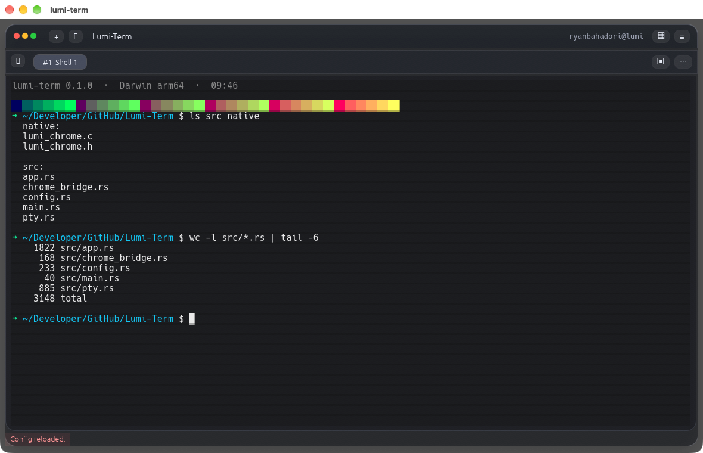

# Lumi-Term

Lumi-Term is a GPU-rendered terminal emulator in Rust for people who want to understand how a terminal works by reading one.

## Run it

```bash
cargo run
```



## What it does

- Runs a real shell in a PTY through `portable-pty`. Window resizes propagate to the PTY, so programs see the new grid.
- Parses VT escape sequences with the `vt100` crate: cursor movement, erase, scrolling, and SGR colors.
- Draws 16 ANSI colors, the 256-color index, and RGB colors, plus bold, dim, italic, underline, and inverse.
- Keeps 10,000 lines of scrollback by default and searches it with `Cmd+F`.
- Opens multiple tabs, one shell each.
- Reloads the config file about two seconds after you save it. A broken edit keeps the last good config instead of killing the session.
- Enables bracketed paste so shells can tell pasted text from typed text.

## How it compares

iTerm2 is the one you already have, and it does the things this does not: split panes, drag-to-select, mouse reporting to programs like vim and htop, clickable links, profiles, and far wider escape sequence coverage. Ghostty, Alacritty, and kitty are the other obvious picks, and all three have years of sequence coverage and platform integration behind them. Lumi-Term is a real terminal you can live in for a shell prompt, and it is not a replacement for any of those.

## Keys

| Shortcut | Action |
| --- | --- |
| `Cmd+F` or `Ctrl+F` | Open scrollback search |
| `Cmd+T` | New tab |
| `Cmd+Shift+W` | Close the active tab |
| `Cmd+Shift+C` or `Ctrl+Shift+C` | Copy the visible screen |
| `Shift+PageUp` / `Shift+PageDown` | Scroll ten lines |
| `Ctrl+End` | Jump back to live output |

## Agent status sidebar

There is no recording of this yet. `docs/demo.md` has the sixty second capture script and what went wrong the last time it was shot.

The panel on the right lists every tab and says whether a coding agent is running inside that tab's shell. It recognises `claude`, `codex`, `opencode`, `gemini`, `droid`, and `aider`, matched on the executable's basename. Click a row to switch to that tab. The `▤` button in the title bar collapses the panel, and when it is closed the grid takes the space back.

Each tab shows one of four states:

- **Running**: an agent process is alive under that tab's shell and the tab produced output in the last 10 seconds.
- **Idle**: the agent process is alive but the tab has been silent for 10 seconds or more. A long tool call with no output looks the same.
- **Exited**: an agent the sidebar had seen is gone. The state stays until another agent starts in that tab, or the tab's session restarts.
- **None**: no agent has been seen in that tab.

There is no shell integration, no prompt hook, and no environment variable involved. Every 3 seconds a background thread runs `ps -axo pid,ppid,comm` once, walks each tab's shell PID down through its descendants, and matches those executables against the agent list. That thread never runs on the render thread; results arrive over a channel.

When an agent that ran for at least 10 seconds exits, a desktop notification goes out through `osascript`. Shorter runs are silent, so a mistyped command that starts and dies does not buzz you. Other platforms get no notification.

What it cannot detect:

- An agent whose executable is not named after the agent, such as a `claude` installed as a `node` script, or any wrapper script around it.
- An agent that starts and exits between two scans. The sidebar samples every 3 seconds, so anything shorter can be missed.
- An agent running under a different tab's shell. The walk is rooted at the tab's own shell PID, so sibling trees are ignored.
- Anything inside tmux, SSH, or a container, where the process tree no longer looks like shell to agent.
- How long an agent really ran. The run clock starts at the first scan that saw it, so an agent already running when Lumi-Term opens looks younger than it is.

## Config

On first launch it writes a TOML config to one of these paths:

- macOS: `~/Library/Application Support/com.lumi.lumi-term/lumi-term.toml`
- Linux: `$XDG_CONFIG_HOME/lumi-term/lumi-term.toml`

```toml
[window]
title = "Lumi-Term"
width = 1280.0
height = 760.0

[terminal]
font_size = 16.0
scrollback = 10000
# shell = "/bin/zsh"            # omit to use your default program
# working_directory = "/"       # omit to start in /

[theme]
background = [17, 17, 17]
foreground = [233, 233, 233]
```

Unknown keys are ignored, and the file is re-read every couple of seconds, so you can change the font size or theme without restarting.

## How it works

```
PTY process -> vt100 parser and screen state (src/pty.rs) -> egui draw (src/app.rs) -> pixels
```

The PTY spawns your shell, reads its output, and parses escape sequences into a screen snapshot. Each frame draws that snapshot with egui. A small C bridge carries tab and window chrome state across the FFI boundary, and Rust's build script compiles it at build time. I wrote the thing to learn the whole path from keystroke to lit pixel.

```
src/
├── main.rs           # eframe entry point, config load, viewport setup
├── app.rs            # app state, tabs, key encoding, grid and chrome drawing, config hot-reload
├── pty.rs            # PTY spawn, VT parsing, screen snapshots, scrollback search
├── agent_status.rs   # process-tree scan, agent matching, per-tab state
├── config.rs         # TOML load-or-create, defaults
└── chrome_bridge.rs  # FFI declarations for the native C chrome bridge

native/
├── lumi_chrome.c     # tab/window chrome state across the FFI boundary
└── lumi_chrome.h
```

## What it does not do yet

- It is not xterm-complete. Common sequences work, uncommon ones do not, and it is not a drop-in replacement for xterm.
- No split panes. The split button in the title bar answers "Split panes are not available yet."
- No mouse. Nothing reads mouse events, so there is no drag-to-select and no mouse reporting for full-screen programs. Copy takes the whole visible screen.
- No clickable links. URLs on screen are just text.
- The menu button is a placeholder. It answers "Main menu actions coming soon."
- The theme section sets only background and foreground. You cannot restyle the 16 ANSI colors.

## Build and test

[](https://github.com/IzonIcy/LumiTerm/actions/workflows/ci.yml)

```bash
cargo build --release
cargo clippy
cargo fmt --check
cargo test
```

CI runs fmt, clippy with warnings as errors, tests, and `cargo check` on Ubuntu. Tagged releases build tarballs for Apple silicon macOS and x86_64 Linux, and v0.1.0 has [both](https://github.com/IzonIcy/LumiTerm/releases/tag/v0.1.0).

## Requirements

Rust toolchain, a C11 compiler for the bridge, and macOS 12+ or Linux with Wayland or X11. On Linux the link step needs the X11 and Mesa development headers: `libx11-dev`, `libxext-dev`, `libxft-dev`, `libxinerama-dev`, `libxcursor-dev`, `libxrandr-dev`, `libxi-dev`, `libgl1-mesa-dev`, `libegl1-mesa-dev`.
